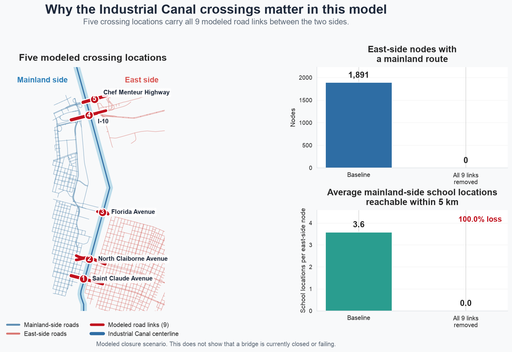
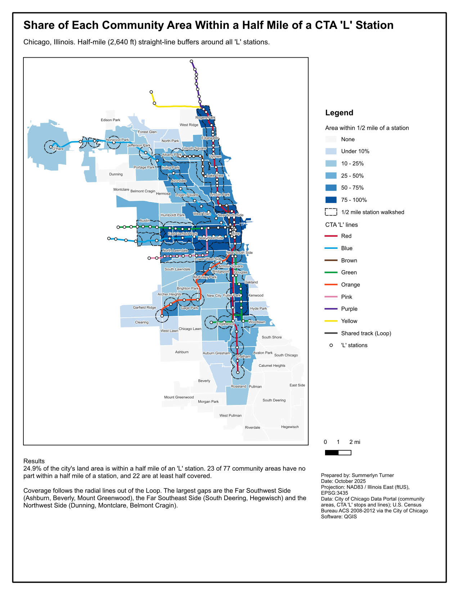
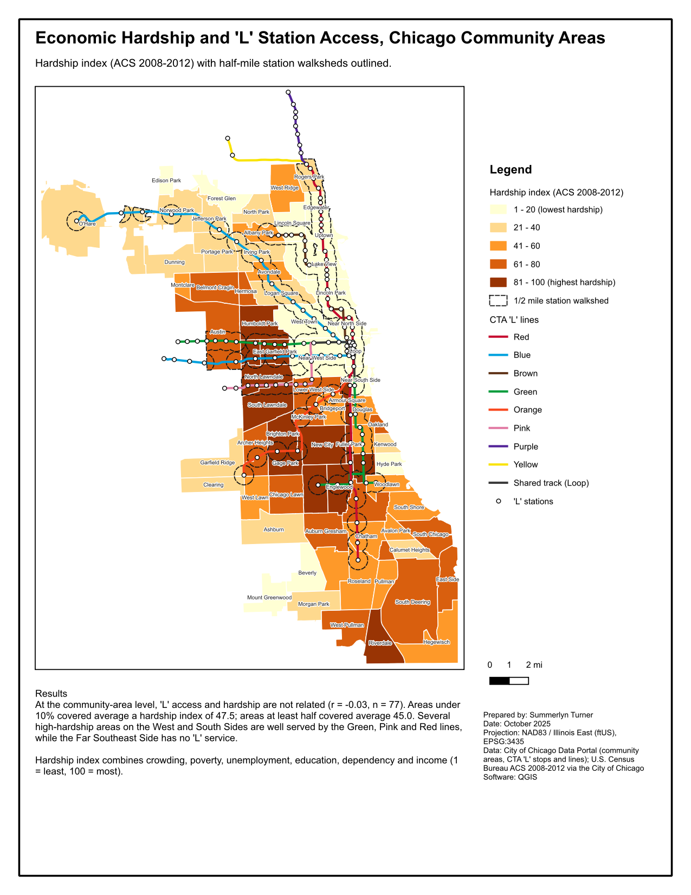

# GIS Portfolio

Summerlyn Turner

Mapping, spatial analysis and network analysis projects. Each folder has its own README with methods, data sources and limitations.

## Projects

### [The Bridge Divides: Industrial Canal Crossing Vulnerability](industrial-canal-network/)
*Georgia Tech OMSA Practicum, Summer 2026. Python, OSMnx, NetworkX, GeoPandas*

Network analysis of the five road crossings over the Industrial Canal in New Orleans. Tests every single, paired and full closure, runs a 100-trial Monte Carlo failure comparison, and links results to bridge records, storm surge data and ACS demographics.

### [Central Boulder: Stream Exposure and Park Access](boulder-creek-access/)
*May 2026. QGIS, PyQGIS, OpenStreetMap*

Buildings within 100 m of Boulder Creek and its tributaries, and walking distance to the nearest park summarized on a 250 m hexagon grid.

| [Stream exposure](boulder-creek-access/maps/map1_stream_exposure.pdf) | [Park access](boulder-creek-access/maps/map2_park_access.pdf) |
| --- | --- |
|  |  |

### [Chicago: 'L' Station Access by Community Area](chicago-transit-access/)
*October 2025. QGIS, PyQGIS, City of Chicago Data Portal*

Half-mile walksheds around all 144 CTA 'L' stations, coverage by community area, and a comparison with the city's hardship index.

| [Station walksheds](chicago-transit-access/maps/map1_station_walksheds.pdf) | [Hardship and access](chicago-transit-access/maps/map2_hardship_access.pdf) |
| --- | --- |
|  |  |

## Skills

QGIS print layouts and Processing toolbox, PyQGIS, CRS selection and reprojection (UTM, State Plane), buffers and overlay analysis, nearest-neighbor joins, hexagon grids, attribute and spatial joins, graduated and categorized symbology, network analysis (NetworkX, OSMnx), Monte Carlo simulation, Census ACS data, GeoPackage, Python (GeoPandas, pandas, matplotlib).
