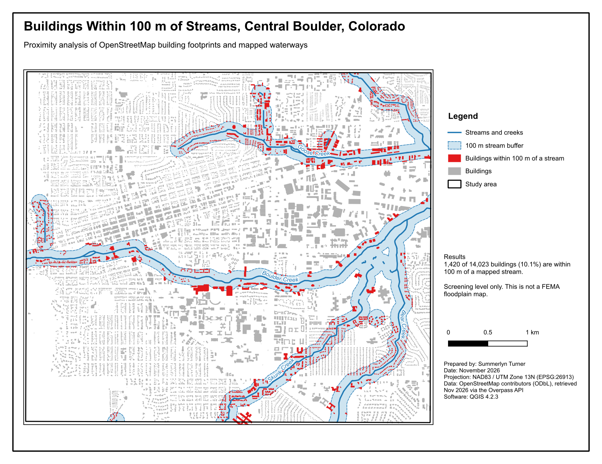
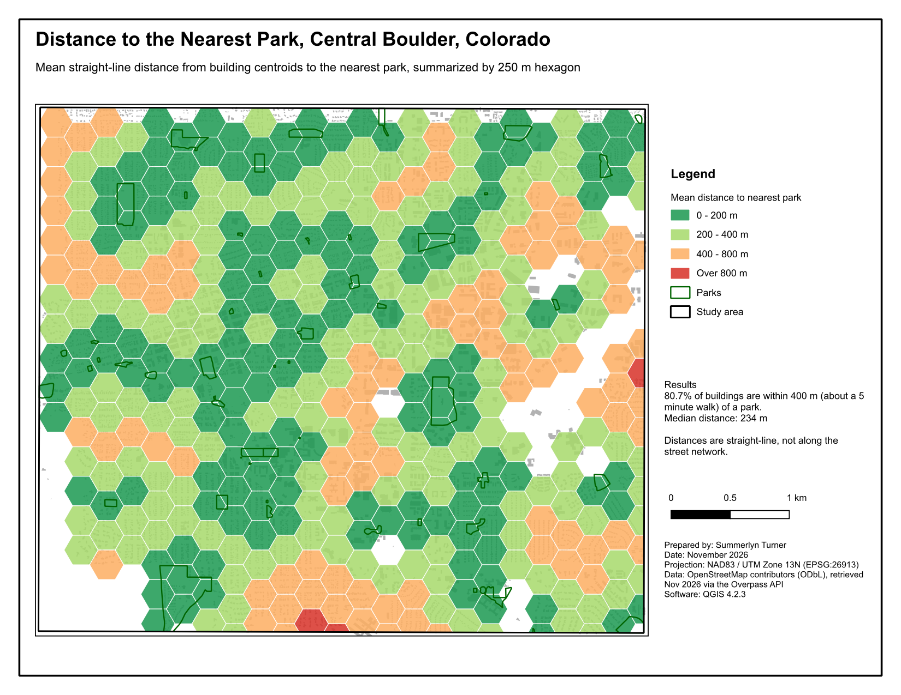

# GIS Portfolio

Summerlyn Turner

Mapping and spatial analysis work done in QGIS. Each project folder has the QGIS project file, the data, the scripts used to process it, and the exported maps.

## Projects

### [Central Boulder: Stream Exposure and Park Access](boulder-creek-access/)

Two proximity analyses of central Boulder, Colorado using OpenStreetMap data.

| Map | Question |
| --- | --- |
| [Buildings within 100 m of streams](boulder-creek-access/maps/map1_stream_exposure.pdf) | How many buildings sit close to Boulder Creek and its tributaries? |
| [Distance to the nearest park](boulder-creek-access/maps/map2_park_access.pdf) | Which parts of the area are more than a 5 minute walk from a park? |

**Skills:** QGIS print layouts, Processing toolbox (buffer, extract by location, join by nearest, hexagon grids, join by location summary), PyQGIS, CRS handling and reprojection, GeoPackage, graduated symbology, cartographic design.
