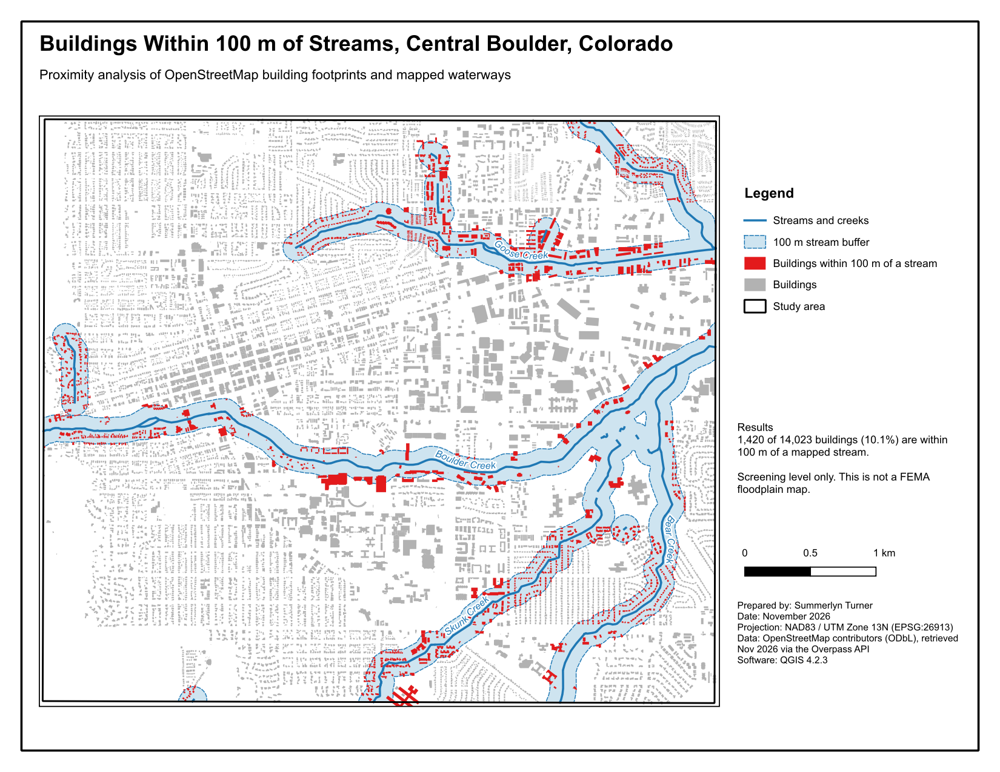
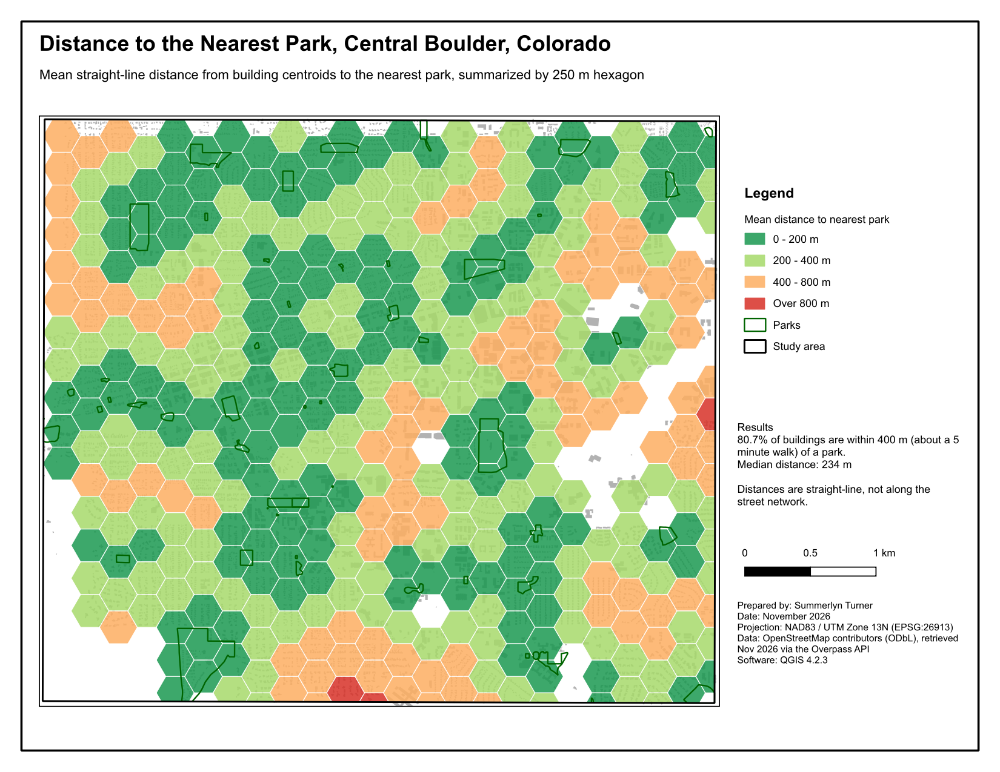

# Central Boulder: Stream Exposure and Park Access

Two proximity analyses for central Boulder, Colorado (about 5 x 4.5 km around downtown and the CU campus), built in QGIS with OpenStreetMap data.

## Maps

| | |
| --- | --- |
| **Buildings within 100 m of streams** ([PDF](maps/map1_stream_exposure.pdf)) | 1,420 of 14,023 building footprints (10.1%) are within 100 m of Boulder Creek or one of its tributaries. |
| **Distance to the nearest park** ([PDF](maps/map2_park_access.pdf)) | 80.7% of buildings are within 400 m of a park (about a 5 minute walk). Median distance is 234 m. |





## Method

All analysis was done in NAD83 / UTM Zone 13N (EPSG:26913) so distances are in meters. The source data comes in as WGS 84, and buffering in degrees or in Web Mercator would give the wrong distances at this latitude.

**Map 1, stream exposure**
1. Reproject streams and buildings to EPSG:26913.
2. Buffer streams by 100 m and dissolve (Buffer).
3. Select buildings that intersect the buffer (Extract by Location, predicate = intersects).

**Map 2, park access**
1. Convert building footprints to centroids (Centroids).
2. Find the nearest park for each building and its distance (Join Attributes by Nearest). Buildings that tie between two parks are de-duplicated.
3. Create a 250 m hexagon grid over the study area (Create Grid).
4. Average the distance per hexagon (Join Attributes by Location (Summary), mean). Hexagons with fewer than 3 buildings are dropped.
5. Graduated symbology with manual breaks at 200, 400 and 800 m.

## Limitations

- This is a screening analysis, not a floodplain study. The FEMA flood maps for Boulder are the authoritative source for flood risk.
- Distances to parks are straight-line. A network analysis along streets and paths would give longer, more realistic walking distances.
- OpenStreetMap completeness varies. Only features tagged `leisure=park` count as parks, so open space, school fields and greenways are not included.

## Files

| Path | Contents |
| --- | --- |
| `boulder_analysis.qgz` | QGIS project with styled layers and both print layouts |
| `data/osm_raw.gpkg` | OSM extract (study area, streams, parks, buildings) in WGS 84 |
| `data/boulder_analysis.gpkg` | Analysis outputs in EPSG:26913 |
| `data/summary_stats.json` | Numbers quoted on the maps |
| `scripts/01_download_osm.py` | Downloads the OSM data through the Overpass API |
| `scripts/02_qgis_analysis_layouts.py` | PyQGIS script that runs the Processing steps and exports the layouts |
| `maps/` | Exported layouts (PDF and PNG) |

## Reproducing

```bash
python scripts/01_download_osm.py          # needs geopandas and requests
```

Then open `boulder_analysis.qgz` in QGIS 4.x, or rerun everything from the OSGeo4W Shell (Windows) or the Python bundled with QGIS (macOS):

```bash
python3 scripts/02_qgis_analysis_layouts.py
```

Data © OpenStreetMap contributors, available under the Open Database License (ODbL).
