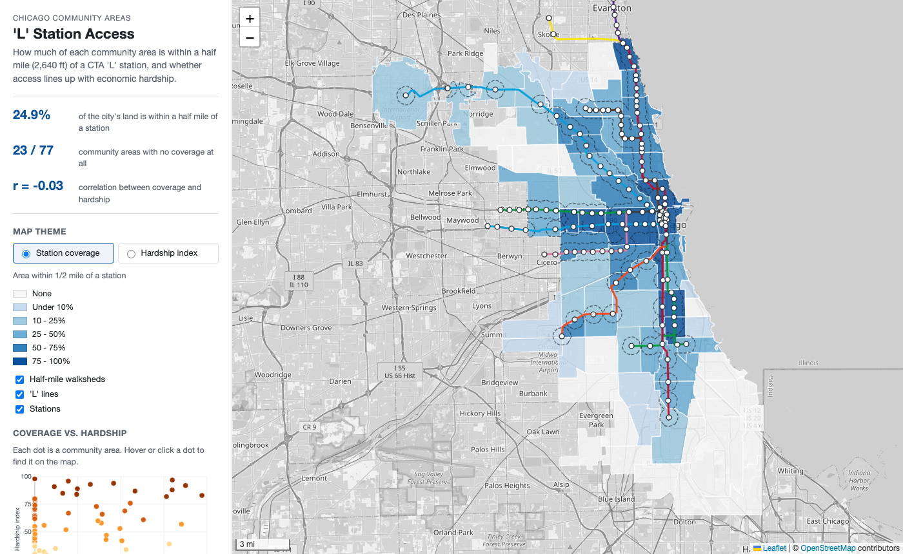

# Chicago: 'L' Station Access by Community Area

**[Open the web map](https://summerturn.github.io/portfolio/chicago-transit-access/webmap/)**

How much of each of Chicago's 77 community areas is within a half mile of a CTA 'L' station, and does station access line up with economic hardship? The analysis runs in QGIS. The results are published as an interactive Leaflet map instead of a print layout.

## What the map does

- Switches between two themes: share of each community area within a half mile of a station, and the city's hardship index.
- Shows half-mile walksheds, 'L' lines in CTA route colors, and all 144 stations. Click a station for its lines and ADA status.
- Click a community area for coverage, station count, hardship index, per capita income and poverty rate.
- A scatter plot of coverage against hardship is linked to the map. Hover or click a dot to find that area.

## Findings

- 24.9% of the city's land area is within a half mile of an 'L' station.
- 23 of 77 community areas have no part within a half mile of a station, and 22 are at least half covered.
- Station coverage and hardship are not related at the community-area level (r = -0.03). Areas under 10% covered average a hardship index of 47.5, and areas at least half covered average 45.0.
- Several high-hardship areas on the West and South Sides are well served by the Green, Pink and Red lines. The Far Southeast Side (South Deering, Hegewisch) has no 'L' service.

## Method

All analysis is in NAD83 / Illinois East (ftUS), EPSG:3435, the State Plane zone the City of Chicago uses, so the half-mile buffer is exactly 2,640 ft.

1. Collapse the CTA stop list (one row per platform direction) to one point per station using `map_id`. This gives 144 stations.
2. Buffer stations by 2,640 ft and dissolve (Buffer).
3. Calculate the share of each community area inside the walkshed (Overlap Analysis).
4. Count stations per community area (Count Points in Polygon).
5. Join the ACS 2008-2012 socioeconomic table on community area number (Join Attributes by Field Value). The CSV ships with a `.csvt` so the numeric columns load as numbers.
6. Simplify, reproject to WGS 84 and export each layer to GeoJSON for the web map.

## Limitations

- Walksheds are straight-line buffers. A network buffer along streets would be smaller.
- Coverage is by land area, not population. A population-weighted version would better measure how many people live near a station.
- The hardship index is from ACS 2008-2012, the most recent version the city has published with this index.
- Buses are not included. Most of the uncovered areas have frequent bus service.

## Files

| Path | Contents |
| --- | --- |
| `webmap/` | The Leaflet web map (`index.html`, `app.js`, `style.css`) and its GeoJSON data |
| `chicago_transit_access.qgz` | QGIS project with the styled analysis layers |
| `data/chicago_source.gpkg` | Community areas, 'L' stations, 'L' lines (WGS 84) |
| `data/socioeconomic_2008_2012.csv` | ACS 2008-2012 indicators by community area (+ `.csvt` column types) |
| `data/chicago_analysis.gpkg` | Analysis outputs in EPSG:3435 |
| `data/summary_stats.json` | Summary numbers |
| `scripts/01_download_data.py` | Downloads the source data from the City of Chicago Data Portal |
| `scripts/02_qgis_analysis_webdata.py` | PyQGIS script for the Processing steps, the QGIS project and the GeoJSON exports |

To run the map locally, serve the `webmap` folder over HTTP (for example `python3 -m http.server --directory webmap`) and open the address it prints.

## Data

- Boundaries - Community Areas (`igwz-8jzy`), City of Chicago Data Portal
- CTA - System Information - List of 'L' Stops (`8pix-ypme`), Chicago Transit Authority
- CTA - 'L' (Rail) Lines (`xbyr-jnvx`), Chicago Transit Authority
- Census Data - Selected socioeconomic indicators in Chicago, 2008-2012 (`kn9c-c2s2`), U.S. Census Bureau ACS via the City of Chicago
- Basemap © OpenStreetMap contributors
