# The Bridge Divides: Industrial Canal Crossing Vulnerability

Georgia Tech OMSA Practicum (CSE/ISYE/MGT 6748), Summer 2026. Research project for Savyminds LLC.

Can a repeatable geospatial network analysis find the road links that matter most, measure what happens when they close, and show who is affected? I tested this on the road network around the Industrial Canal in New Orleans, where traffic between the two sides can only cross at five locations.

This folder has the figures and policy brief from the project. The analysis pipeline is in Python (OSMnx, NetworkX, GeoPandas, Folium).

## Key findings

- The 5 km road graph has 2,383 nodes and 6,715 directed edges. Nine modeled road links cross the canal at five locations: Chef Menteur Highway, I-10, Florida Avenue, North Claiborne Avenue and Saint Claude Avenue.
- No single closure isolates the east side. The largest single-location loss is 1.6% for 3 km node access and 1.4% for 5 km critical-service access.
- Closing North Claiborne and Saint Claude together cuts 5 km critical-service access by 15.4% and raises mean time to the nearest mainland node by 29.1%.
- Closing all nine links leaves 0 of 1,891 east-side nodes connected to the mainland side. Node access falls 6.8% and critical-service access falls 23.1%.
- Over 100 Monte Carlo trials, random failure keeps 96.8% of baseline efficiency after 120 removals, while targeted removal of high-betweenness links ends at 93.4%.
- The east-side block groups (ACS 2024) are 79.3% Black with a 25.2% poverty rate, compared with 43.1% and 21.3% for the rest of Orleans Parish.

## Figures

| Figure | What it shows |
| --- | --- |
| 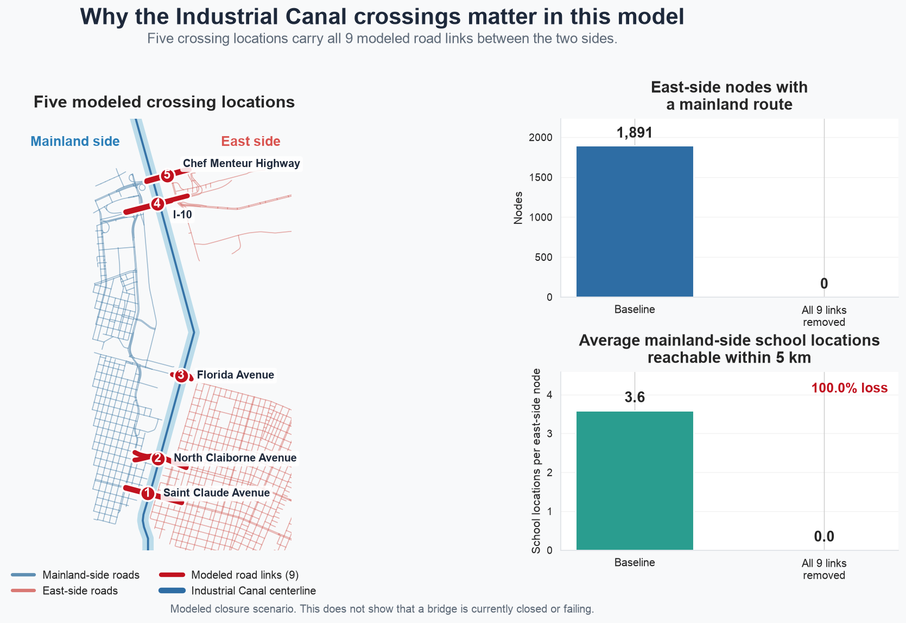 | The five crossing locations and what happens when all nine links are removed |
| 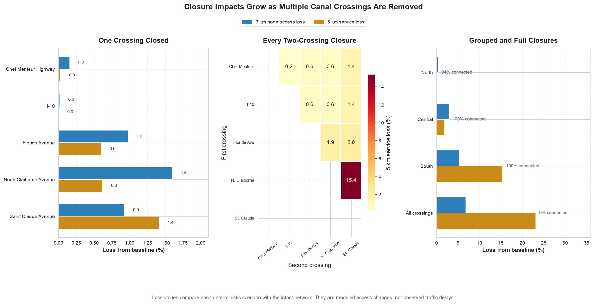 | Single, paired, grouped and full closure results |
| 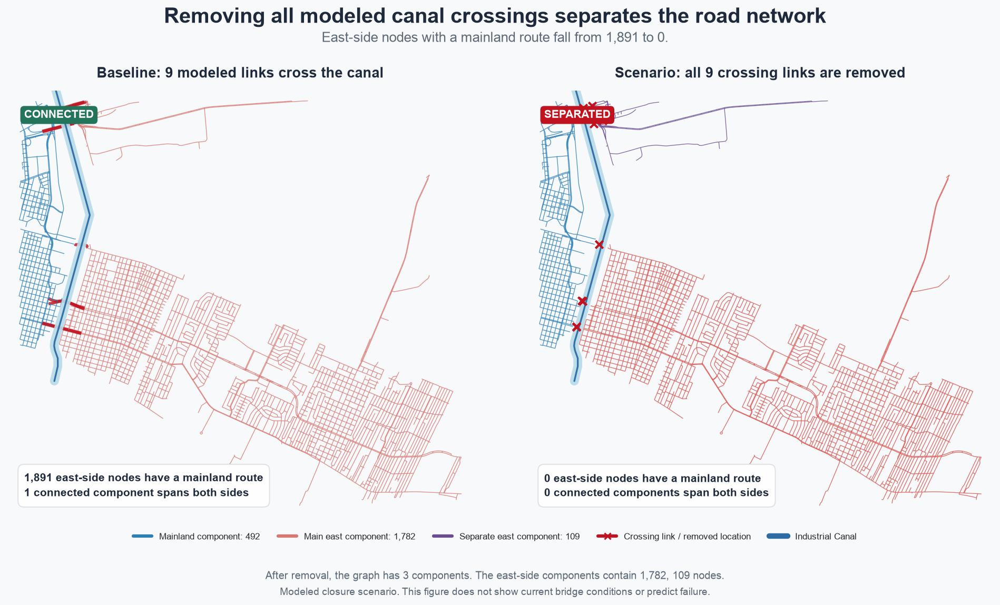 | East-side connectivity before and after the full closure |
| 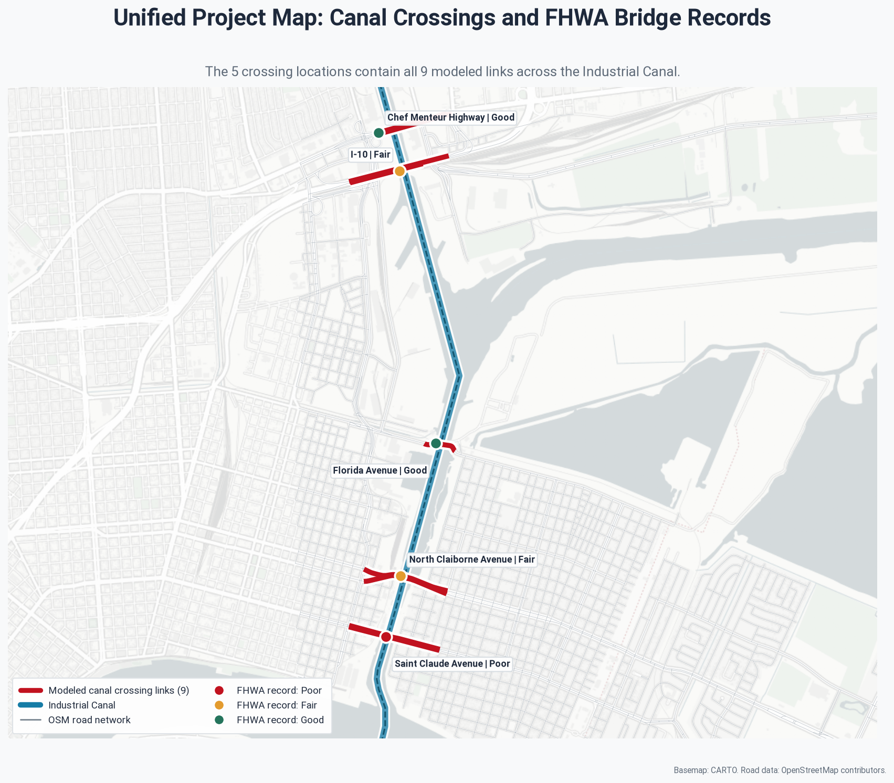 | Infrastructure view: crossings, matched NBI bridge records, flood overlay |
| 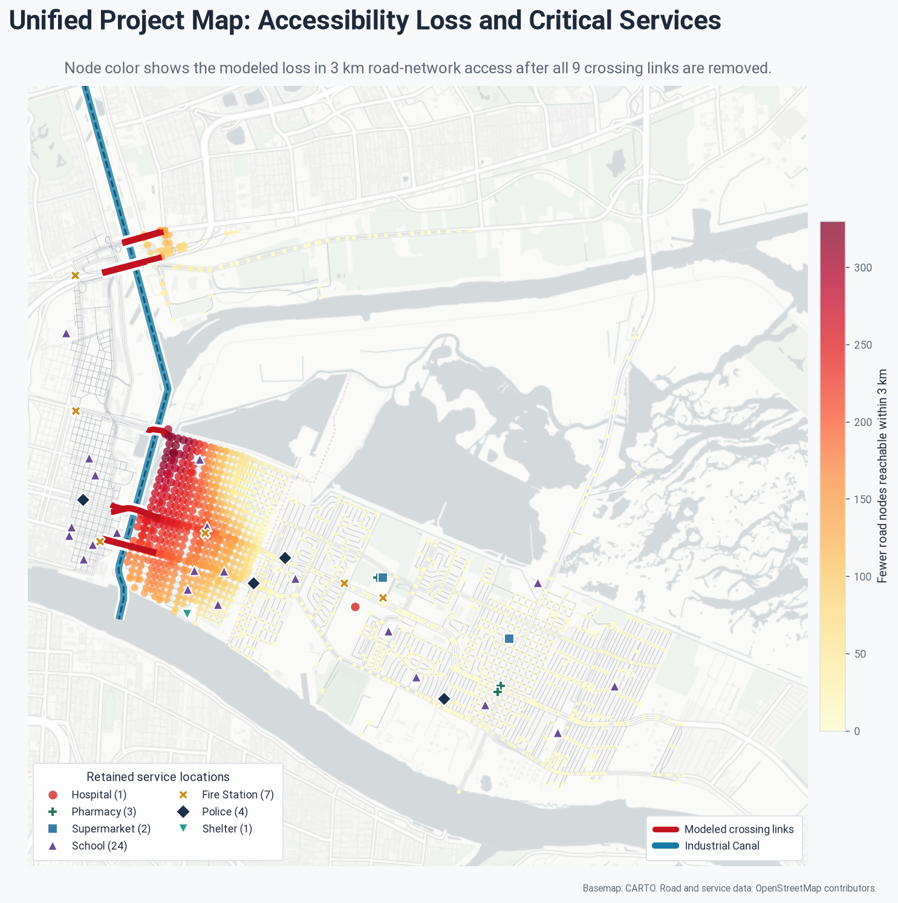 | Service access view: hospitals, schools, fire, police, shelters |
| 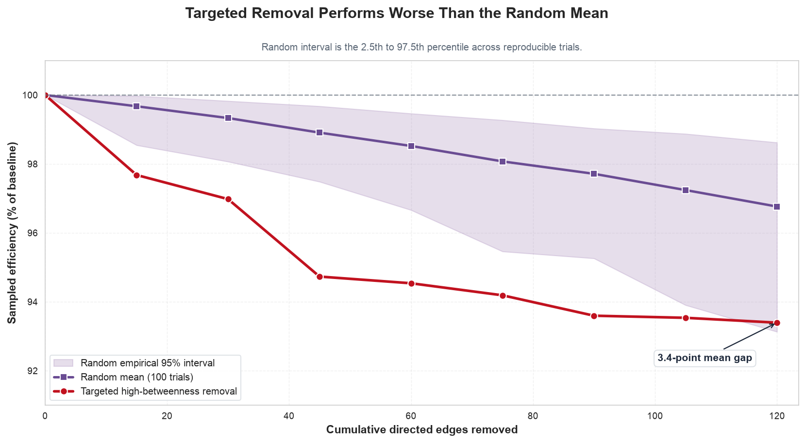 | 100-trial random failure compared with targeted removal |
| 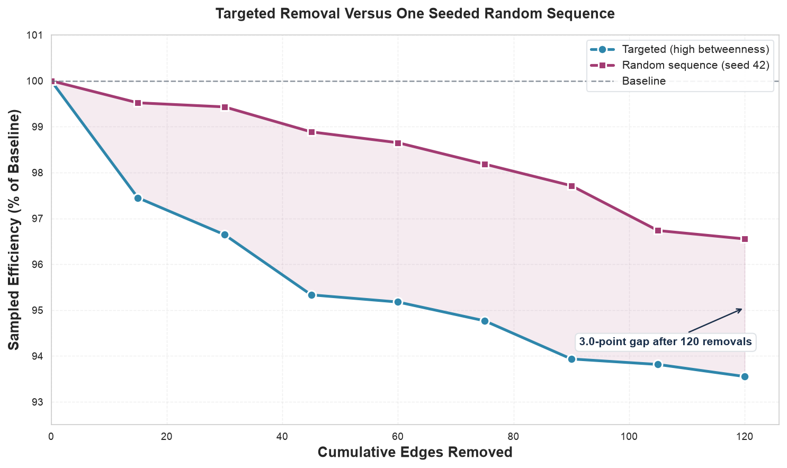 | Random vs. targeted efficiency loss |
| 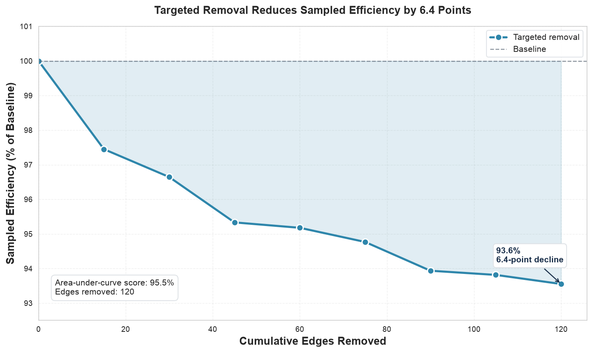 | Network efficiency as high-betweenness links are removed |
| 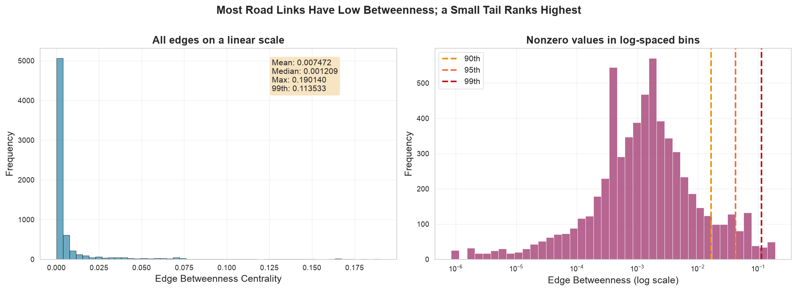 | Edge betweenness centrality distribution |
| 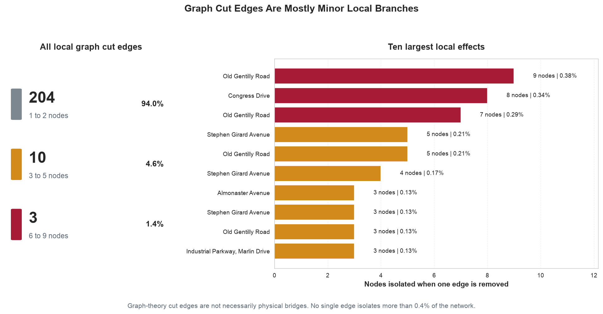 | Nodes isolated by each graph bridge |
| 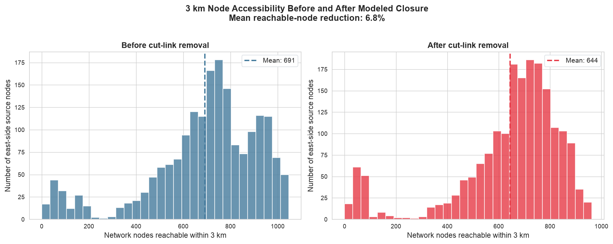 | 3 km node accessibility before and after closure |
| 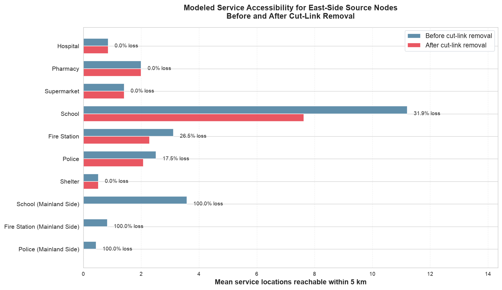 | Service access by category before and after closure |
| 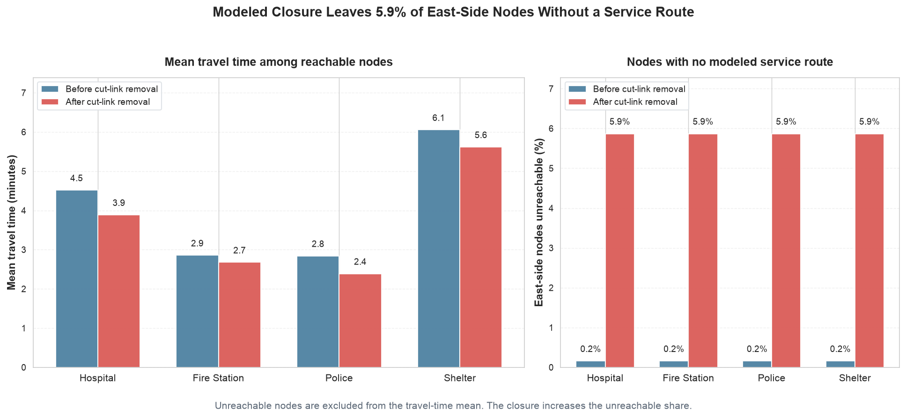 | Emergency response reachability and travel times |
| 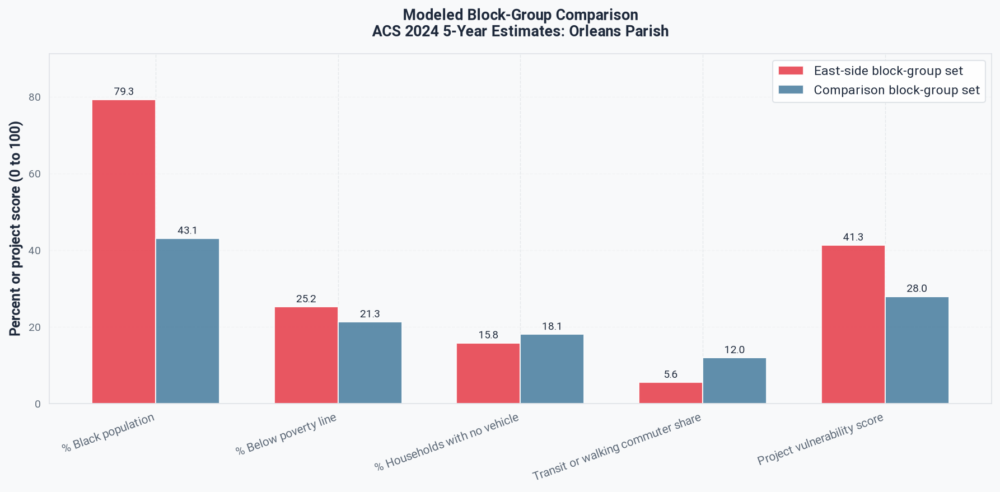 | ACS 2024 demographic comparison, east side vs. comparison set |

Policy brief: [policy_brief.pdf](policy_brief.pdf)

## Methods in brief

1. Download the drive network around the canal from OpenStreetMap (OSMnx) and split nodes by the canal centerline.
2. Find links crossing the canal, graph bridges and biconnected components.
3. Test every single crossing, all ten crossing pairs, three geographic groups and the full closure.
4. Measure 3 km node accessibility and 5 km service accessibility before and after each closure.
5. Run targeted (betweenness) and 100-trial random failure stress tests.
6. Match crossings to FHWA National Bridge Inventory records and overlay NOAA SLOSH storm surge rasters.
7. Compare ACS 2024 block-group demographics for the east-side and comparison sets.

## Limitations

These are modeled scenarios, not an engineering assessment. The canal line is an OpenStreetMap centerline, NBI matches are automated and preliminary, and closures don't account for traffic, duration or probability of failure.

Data: OpenStreetMap contributors (ODbL); U.S. Census Bureau ACS 2024 5-year; FHWA National Bridge Inventory 2025; NOAA SLOSH MOM v4.
